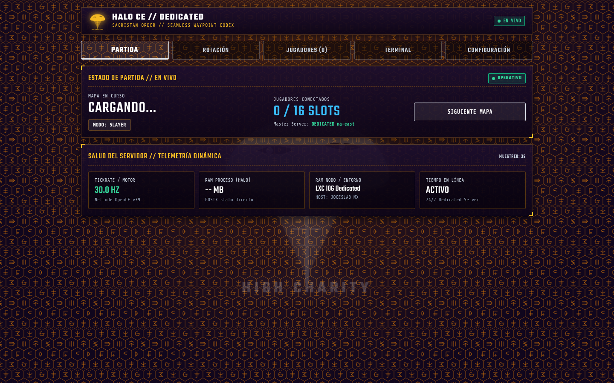

<div align="center">

# Halo CE Dedicated Server

**Headless 24/7 dedicated server for Halo: Combat Evolved (OpenCE)**

<p align="center">
  <b>English</b> • <a href="README.es.md">Español</a>
</p>

[](https://github.com/JoshRob297/halo-ce-server/releases/latest)
[](#quick-start-docker)
[](#who-can-join)
[](#web-dashboard)
[](docs/anticheat.md)
[](LICENSE)

Run a continuous multiplayer or co-op host with **no screen, no GPU, and no sound card**.<br/>
Built on the [OpenCE](https://github.com/OpenCommunityEdition/OpenCE) native port (`dhost-v39`).

[Quick Start](#quick-start-docker) • [Full Guide](#the-complete-guide-step-by-step) • [Web Dashboard](#web-dashboard) • [Master Server Registration](docs/master-registration.md) • [Operator CLI](#operator-cli-operatorsh) • [Raspberry Pi ARM64](docs/raspberry-pi.md) • [Settings](#the-settings) • [Guía en Español](README.es.md)

</div>

---

### Highlights

- **Native OpenCE Netcode (v39):** Official OpenCE clients (Windows, Linux, Android, Web) connect directly without modifications.
- **Automated Map Rotation:** Define map and gametype sequences directly in `config.toml`; the server rotates and resets the lobby automatically.
- **Server Browser Discovery:** Fully discoverable in the in-game public browser or shareable via direct invite links (`halo://join/...`).
- **Low Footprint:** Runs with a null renderer and SDL dummy drivers. Lightweight enough for a basic VPS, NUC, or mini-PC.

---

## Architecture Overview

```
+-------------------------------------------------------------------------+
|                              HOST MACHINE                               |
|                                                                         |
|  +--------------------------- Docker / Bare Metal --------------------+ |
|  |                                                                    | |
|  |  Game Engine (OpenCE Core) <---> config.toml (Rotation & Limits)   | |
|  |       |                                                            | |
|  |  Virtual Audio / Video Drivers (SDL dummy, null renderer)          | |
|  |       |                                                            | |
|  |  Network Listener (UDP 2302)                                       | |
|  +-------|------------------------------------------------------------+ |
+----------|--------------------------------------------------------------+
           |
           +---> STUN / Master Browser Discovery
           |
           +---> Incoming Clients (PC, Android, Linux, Web)
```

---

## Web Dashboard

The dedicated server includes a native, zero-dependency embedded Tactical Web Dashboard listening on port `:8080`, engineered with high-contrast tactical HUD styling and 6 lore-authentic visual identities (UNSC, ONI, and Covenant) switchable on the fly with local persistence.

<p align="center">
  
</p>

### Key Dashboard Modules (6 Tactical Tabs)
- **Partida (Live Match & Health):** Instant visibility of active map, gametype, and connected slots (`0 / 16`), backed by grouped telemetry (tickrate 30 Hz, POSIX native process RAM from `/proc/self/statm`, node RAM, and continuous uptime) with quick actions (`Next Map`, `Restart`, `Stop Game`).
- **Jugadores (Player Administration):** Connected player table with real-time ping, score, team assignment, and moderation controls (`Kick`, `Ban`, `Mute`, `Team Swap`), plus IP blacklist controls.
- **Rotación (Rotation & Mapcycle):** Playlist cycle manager with sequence/shuffle modes, in-lobby chat map voting toggle (`network.map_voting`), match duration and lobby countdown presets.
- **Servidor (Server Operations):** Live configuration of server name, UDP port, public browser listing, region (`server.region`), chat/name filtering (`server.chat_filter`), AFK timeout, and P2P map sharing.
- **CO-OP (Massive Campaign):** Dedicated campaign co-op parameters: enemy difficulty scaling (`network.coop_enemies_mode`), pickup replenishing (`network.coop_pickups`), and friendly fire rules (`network.coop_friendly_fire`).
- **Consola (Terminal, Logs & Themes):** In-browser interactive HaloScript command terminal, live `debug.txt` real-time viewer, and tactical theme switcher with 6 authentic identities (Mjolnir Titanium, ONI Black Ops, Command Amber, Fleet Plasma, Sacristan Gold Codex, Zealot Cyan Codex).

For the complete REST API specification, JSON payloads, and HTTPS reverse proxy setup, see [docs/web-dashboard.md](docs/web-dashboard.md).

<p align="center">
  &nbsp;
  
</p>
<p align="center">
  
</p>

---

## Contents

- [What You Need](#what-you-need)
- [Quick Start (Docker)](#quick-start-docker)
- [The Complete Guide, Step by Step](#the-complete-guide-step-by-step)
- [Web Dashboard](#web-dashboard)
- [Operator CLI (operator.sh)](#operator-cli-operatorsh)
- [Multi-Platform & Hardware](#multi-platform--supported-hardware)
- [Windows Headless](#windows-headless)
- [The Settings](#the-settings)
- [Maps and Game Modes](#maps-and-game-modes)
- [Campaign Co-op (Up to 128 Players)](#campaign-co-op-up-to-128-players)
- [Bots, Custom Maps, and Mods](#bots-custom-maps-and-mods)
- [Who Can Join](#who-can-join)
- [Troubleshooting](#troubleshooting)
- [Roadmap & Limitations](#roadmap--limitations)
- [Feature Comparison: Our Edition vs Upstream](#feature-comparison-our-edition-vs-upstream-branch)
- [Credits & Attribution](#credits--attribution)

---

## What You Need

1. **Game Map Files:** You must supply the `maps/` folder extracted from **your legally owned retail disc**. The server never contains or distributes copyrighted game data.
2. **Runtime Environment:**
   - **Docker** (Recommended across all platforms), or
   - **Linux x86_64** (systemd service), or
   - **Windows** (Console / NSSM service).
3. **Network Accessibility:** One inbound UDP port (default: `2302`). UPnP is attempted automatically, but manual port forwarding is advised for dedicated servers.

### Map Extraction

A multiplayer server requires `ui.map` and any level intended for the map cycle (`bloodgulch.map`, `chillout.map`, etc.). Co-op servers additionally require the campaign maps (`a10.map`, `c10.map`, etc.). Custom Edition maps should be placed inside a `custom_maps/` directory.

Extracting and importing maps from your retail disc image (100% legal automated tool):

```sh
# Using the automated importer tool:
./scripts/import-maps.sh "Halo - Combat Evolved (USA).iso"

# Or manual extraction using extract-xiso / 7-Zip:
extract-xiso -x "Halo - Combat Evolved (USA).xiso.iso"
# Or: 7z x "Halo - Combat Evolved (USA).xiso.iso" maps/
```

---

## Quick Start (Docker)

Ensure Docker and Docker Compose are installed, then run:

```sh
# 1. Prepare directory structure
mkdir -p halo-server/maps

# 2. Copy extracted maps into the server folder
cp /path/to/extracted/maps/* halo-server/maps/

# 3. Retrieve compose configuration
cd halo-server
curl -fsSL -O https://raw.githubusercontent.com/JoshRob297/halo-ce-server/main/docker-compose.yml

# 4. Launch the server daemon
docker compose up -d

# 5. Monitor startup
docker compose logs -f
```

Expected log output upon successful startup:

```text
halo-linux: Internet play: hosting. Invite players with this link: halo://join/...
halo-linux: Internet play: the game is listed in everyone's server browser (public)
halo-linux: network test: hosting bloodgulch
```

---

## The Complete Guide, Step by Step

### Step 1: Prepare Game Assets

Create a clean directory for your deployment and organize the maps:

```sh
mkdir -p ~/halo-server/maps
cd ~/halo-server

# Required core UI map
cp /path/to/extracted/maps/ui.map ./maps/

# Desired multiplayer levels
cp /path/to/extracted/maps/bloodgulch.map ./maps/
cp /path/to/extracted/maps/chillout.map ./maps/
cp /path/to/extracted/maps/damnation.map ./maps/
cp /path/to/extracted/maps/sidewinder.map ./maps/
```

### Step 2: Download Docker Configurations

```sh
curl -fsSL -O https://raw.githubusercontent.com/JoshRob297/halo-ce-server/main/docker-compose.yml
curl -fsSL -O https://raw.githubusercontent.com/JoshRob297/halo-ce-server/main/server/config.toml
```

### Step 3: Configure Server Parameters

Open `config.toml` in your preferred editor:

```toml
[network]
server_name = "My 24/7 Halo Server"   # Shown in the in-game Server Browser
tunnel_port = 2302                    # Inbound UDP port for game traffic

[debug]
null_renderer = true
# Semicolon-separated map and mode definitions:
network_test = "host:bloodgulch:slayer,ctf;chillout:slayer,oddball;sidewinder:ctf"
network_test_time = 15                # Match time limit in minutes
network_test_countdown = 15           # Pre-game lobby countdown in seconds
network_test_player = true            # Spawns idle host player so match starts and allows hot-joining
```

Update `docker-compose.yml` to mount your custom `config.toml`:

```yaml
volumes:
  - ./maps:/halo/maps:ro
  - ./saved:/root/.local/share/halo-linux
  - ./config.toml:/halo/config.toml:ro
```

### Step 4: Firewall and Networking

If hosting on a VPS or behind a router with disabled UPnP, forward UDP port `2302`:

```sh
# UFW (Ubuntu / Debian)
sudo ufw allow 2302/udp

# FirewallD (RHEL / Fedora)
sudo firewall-cmd --add-port=2302/udp --permanent
sudo firewall-cmd --reload

# Windows (PowerShell as Administrator)
New-NetFirewallRule -DisplayName "Halo CE Server" -Direction Inbound -Protocol UDP -LocalPort 2302 -Action Allow
```

### Step 5: Launch and Inspect

```sh
docker compose up -d
docker compose logs -f
```

---

## Bare-Metal Installation (systemd)

If you prefer to run directly on the host without containerization:

```sh
# 1. Run the automated installer
sudo curl -fsSL https://raw.githubusercontent.com/JoshRob297/halo-ce-server/main/scripts/install-baremetal.sh | sudo bash -s -- /srv/halo

# 2. Place map files
sudo cp /path/to/extracted/maps/* /srv/halo/maps/

# 3. Adjust settings
sudo nano /srv/halo/config.toml

# 4. Start the service
sudo systemctl enable --now halo-server
sudo journalctl -u halo-server -f
```

---

## Operator CLI (operator.sh)

The server includes a lightweight management CLI (`scripts/operator.sh`) communicating directly with the internal administration console over loopback telnet (`127.0.0.1:2323`).

### Enabling the Console
In `config.toml`:
```toml
[debug]
telnet_console = true
telnet_console_port = 2323
```
Or via environment variable:
```bash
export HALO_TELNET_CONSOLE=true
```

### Usage with Docker
Run commands from the host machine using `docker exec`:
```bash
# Check live match status (map, mode, players, state)
docker exec halo-server /halo/operator.sh status

# Disconnect a disruptive player
docker exec halo-server /halo/operator.sh kick "PlayerName"

# Ban a player (writes IP + HWID with progressive tier)
docker exec halo-server /halo/operator.sh ban "Griefer"

# Trigger a host vote-kick
docker exec halo-server /halo/operator.sh votekick "AfkPlayer"

# Execute arbitrary Halo Script or debug commands
docker exec halo-server /halo/operator.sh raw "help kick"
```

### Usage on Bare Metal / Systemd
```bash
/opt/halo-server/operator.sh status
/opt/halo-server/operator.sh kick "PlayerName"
```

### Safe Automated Updates (`halo-update.sh`)
Update to the latest release and Netcode version safely with SHA-256 verification and automatic rollback:
```bash
# Check if a new release is available
sudo /opt/halo-server/scripts/halo-update.sh /opt/halo-server --check

# Apply update with SHA-256 integrity check, backup, and smoke test
sudo /opt/halo-server/scripts/halo-update.sh /opt/halo-server
```

See [docs/operator.md](docs/operator.md) for the full guide, including chat settings, progressive ban tiers, lobby map voting, and the HTTP health endpoint.

---

## Multi-Platform & Supported Hardware

The server is engineered for maximum portability across architectures, operating systems, and form factors:

| Platform / Architecture | Supported Hardware | Deployment Method | Notes |
| :--- | :--- | :--- | :--- |
| **Linux ARM64 (`aarch64`)** | **Raspberry Pi 3B / 3B+ / 4 / 5**, Orange Pi 5, **Oracle Cloud Ampere A1**, AWS Graviton | **Docker (`linux/arm64`)** or Bare-Metal systemd | Ultra-low power (2.5W to 4W). Uses ~85 MB RAM. Full guide: [docs/raspberry-pi.md](docs/raspberry-pi.md). |
| **Linux x86_64 (`amd64`)** | VPS (Hetzner, Linode, DigitalOcean, OVH), Proxmox VE / LXC, Bare Metal PC | **Docker (`linux/amd64`)** or Bare-Metal systemd | Default deployment for homelabs and cloud servers. |
| **Linux x86 (`i686`)** | Legacy 32-bit hardware, older VPS | Bare-Metal ELF binary | Maximum legacy compatibility. |
| **Windows x86_64 / x86** | Windows 10/11, Windows Server 2016-2025 | Native `.exe` or NSSM background service | Runs with dummy SDL drivers (no GPU/audio needed). Full guide: [docs/windows.md](docs/windows.md). |

---

## Windows Headless

The dedicated server runs natively on Windows using headless SDL dummy drivers without a display or sound card.

- **Guide & Service Setup:** See [docs/windows.md](docs/windows.md) for full instructions, manual startup commands (Command Prompt and PowerShell), Windows Firewall rules, and running as an auto-restarting background service via NSSM.
- **CI Verification:** The `windows` job on GitHub Actions (`windows-2025`) continuously builds and smoke-tests headless startup with `SDL_VIDEODRIVER=dummy SDL_AUDIODRIVER=dummy`.

---

## The Settings

All configuration is handled inside `config.toml` (or via corresponding environment variables):

| Parameter | Type | Default | Description |
| :--- | :--- | :--- | :--- |
| `debug.null_renderer` | Boolean | `true` | Suppresses graphics and window rendering. |
| `debug.network_test` | String | `""` | Rotation specifier: `"host:map:mode,mode;map:mode"`. |
| `debug.network_test_time` | Integer | `0` | Hard match limit in minutes (overrides game variant). |
| `debug.network_test_countdown`| Integer | `0` | Seconds to hold the pre-game countdown (0 = 31s). |
| `debug.network_test_start` | Float | `1.0` | Fallback timeout to enforce start if conditions hang. |
| `debug.network_test_player` | Boolean | `true` | `true`: spawns idle host player to advance countdown; allows hot-joining. |
| `audio.enabled` | Boolean | `false`| Prevents opening any audio device. |
| `network.server_name` | String | `""` | Display name for the public server browser (Max 32 chars). |
| `network.tunnel_port` | Integer | `2302` | Inbound network port. |
| `network.online` | Boolean | `true` | Enables WAN/Internet functionality (`false` = LAN only). |
| `network.host_public` | Boolean | `true` | Broadcasts listing to the public server browser. |
| `network.public_chat` | Boolean | `true` | Enables text chat on moderated public dedicated games. |
| `network.server_password`| String | `""` | Join password with Argon2id hash (empty = open server). |
| `network.map_rotation` | String | `"sequence"`| Playlist mode: `"sequence"` (in order) or `"shuffle"` (random without immediate repeats). |
| `network.map_voting` | Boolean | `false` | Enables lobby map voting so players pick next map in chat. |
| `network.map_vote_options`| Integer | `3` | Number of map/gametype candidates presented in vote (2 to 5). |
| `network.afk_timeout` | Integer | `180` | Inactivity timeout in seconds before auto-kick (warning at T-30s, 0 = off). |
| `network.escalating_bans`| Boolean | `true` | Progressive strike-based bans: 1h -> 24h -> 7d -> permanent. |
| `network.health_port` | Integer | `0` | TCP port for Web Dashboard and REST API (0 = disabled). |
| `server.region` | String | `"eu"` | Region label displayed in Server Browser (Ping column: EU, NA-E, SA). |
| `server.chat_filter` | String | `"off"` | Chat and player name moderation filter mode (`"off"`, `"censor"`, `"block"`). |
| `server.chat_filter_slurs` | String | `"mild"` | Severity filter level for slurs (`"off"`, `"severe"`, `"strong"`, `"mild"`). |
| `server.chat_filter_swearing` | String | `"off"` | Severity filter level for swearing and explicit language (`"off"`, `"severe"`, `"strong"`, `"mild"`). |
| `server.chat_filter_insults` | String | `"off"` | Severity filter level for general insults (`"off"`, `"severe"`, `"strong"`, `"mild"`). |
| `display.time_notices` | Boolean | `true` | Broadcasts match time milestones via chat. |

---

## Maps and Game Modes

### Supported Maps
Any map file present in `maps/` can be targeted by its base name:
`bloodgulch`, `chillout`, `damnation`, `hangemhigh`, `longest`, `prisoner`, `putput`, `ratrace`, `sidewinder`, `beavercreek`, `boardingaction`, `carousel`, `wizard`.

For Custom Edition maps located in `custom_maps/`, specify them with the subfolder prefix:
`custom_maps\cbeaver`

### Supported Gametypes
Chain multiple modes per map entry in `config.toml` using commas:

| Gametype Identifier | Category | Rules & Mechanics |
| :--- | :--- | :--- |
| **`slayer`** / **`team_slayer`** | Classic Halo | Free for all or team deathmatch. |
| **`ctf`** / **`ironctf`** | Classic Halo | Capture The Flag. `ironctf` disables touch-return. |
| **`oddball`** / **`team_oddball`** | Classic Halo | Hold the skull for points. Ball carrier uses skull melee. |
| **`king`** / **`team_king`** | Classic Halo | King of the Hill. Accumulate time inside moving hill. |
| **`race`** / **`team_race`** / **`rally`** | Classic Halo | Drive vehicles through checkpoint sequence. |
| **`swat`** | **OpenCE Custom** | No shields, instant headshot kills with any weapon, pistol + assault rifle spawn, no radar, no grenades on map. |
| **`infection`** | **OpenCE Custom** | Humans (Red) vs Zombies (Blue/Green). Zombies have increased speed, skull melee only. Humans killed become zombies. |
| **`gun_game`** | **OpenCE Custom** | Free for all. Each kill awards the next weapon in sequence. Kill with final weapon wins the match. |
| **`hardcore`** / **`hardcore_slayer`**| **OpenCE Custom** | No motion sensor, no aim assist. Each kill instantly restores full health and shields to the killer. |
| **`hardcore_ctf`** | **OpenCE Custom** | Capture The Flag with hardcore rules (no radar, no aim assist, kill regen). |
| **`hardcore_oddball`** | **OpenCE Custom** | Oddball with hardcore rules (no radar, no aim assist, kill regen). |
| **`hardcore_king`** | **OpenCE Custom** | King of the Hill with hardcore rules (no radar, no aim assist, kill regen). |
| **`coop`** | Campaign | Campaign cooperative missions (`a10`, `b30`, etc.). |

---

## Campaign Co-op (Up to 128 Players)

The server natively hosts the complete original Halo campaign online for **up to 128 players simultaneously** (default lobby limit is 16, configurable up to 128 via `HALO_PORT_MAXIMUM_NETWORK_PLAYERS`, whereas original Xbox was limited to 2 split-screen).

### How to Host Co-op Campaign
In `config.toml`, set the campaign mission and `coop` gametype in `network_test`:
```toml
[debug]
# Host a specific mission:
network_test = "host:a10:coop"
# Or a mission playlist sequence:
# network_test = "host:a10:coop;a30:coop;b30:coop;c10:coop"
```

### Campaign Mission IDs
| Level ID | Map File | Mission Name |
| :--- | :--- | :--- |
| **`a10`** | `a10.map` | The Pillar of Autumn |
| **`a30`** | `a30.map` | Halo |
| **`a50`** | `a50.map` | The Truth and Reconciliation |
| **`b30`** | `b30.map` | The Silent Cartographer |
| **`b40`** | `b40.map` | Assault on the Control Room |
| **`c10`** | `c10.map` | 343 Guilty Spark |
| **`c20`** | `c20.map` | The Library |
| **`c40`** | `c40.map` | Two Betrayals |
| **`d20`** | `d20.map` | Keyes |
| **`d40`** | `d40.map` | The Maw |

### Special Co-op Settings in `config.toml`
- `network.coop_enemies_mode = "per_player"`: Automatically scales Covenant squad sizes based on player count (up to 8x enemies to balance large lobbies).
- `network.coop_pickups = "per_player"`: Scales weapons, health packs, and ammunition across the level.
- `network.coop_friendly_fire = "on"`: Friendly fire rules (`"off"`, `"on"`, `"shields_only"`, `"explosives_only"`).
- `coop_vehicles`: Cutscene Pelicans automatically drop additional Warthogs when more players are in the squad.
- `coop_spectate`: Dead players enter third-person spectate camera following living teammates until respawn.

---

## Bots, Custom Maps, and Mods

### Intelligent Multiplayer Bots
The server includes native multiplayer bot AI (`bots.c`) that navigates maps, engages with weapons, and contests objectives (Slayer, CTF, King of the Hill):
- In `config.toml`: `bots.count = 4` (spawns 1 to 16 AI bots to fill empty slots).
- Via RCON / Web Console: `bots.count = 8` or `bots.skill = "expert"`.

### P2P Torrent Map Sharing (`map_share`)
OpenCE includes a native BitTorrent-style P2P protocol (`map_share.c`):
- Place Custom Edition maps into the `custom_maps/` directory (e.g. `custom_maps/hugeass.map`).
- When a player connects without the map, the server hashes the file (SHA-256) and distributes pieces.
- Existing players who already have the map act as seeders, uploading pieces in parallel.
- Map downloads happen in the background without blocking ongoing gameplay; players join hot upon completion.
- Bandwidth throttling: `network.map_share_upload = 1024` (max KB/s dedicated to map downloads to protect tick rate).

### Tag Mods (HEK and Invader)
The engine supports tag-based mods placed in the `mods/` directory:
- Structure: `mods/<mod_name>/mod.toml` with a `tags/` subfolder.
- Replaces textures, audio, text strings, and weapon/vehicle geometry from Halo PC tag files without breaking network synchronization with vanilla clients.
- Automated load order resolution with `load_order.toml`.

> **Automatic Fallback:** If a gametype requires teams (e.g. CTF) and fewer than two players join, the engine automatically selects the first non-team variant to ensure the game cycle continues smoothly.

---

## Who Can Join

| Client Type | Version | Status |
| :--- | :--- | :--- |
| **OpenCE Official (Desktop)** | v38 / v39 | Supported directly |
| **OpenCE Android APK** | v38 / v39 | Supported directly |
| **OpenCE WebAssembly Browser** | v38 / v39 | Supported directly |
| **Legacy OpenCE Clients** | ≤ v37 | Upgrade client required |

The netcode strictly requires version alignment on the client side. Current official master releases operate on network version 39.

---

## Troubleshooting

### `SDL_Init failed: No available video device`
Occurs when running the binary outside Docker without headless environment overrides. Ensure dummy drivers are exported:
```sh
export SDL_VIDEODRIVER=dummy
export SDL_AUDIODRIVER=dummy
```

### Server Does Not Appear in Server Browser
1. Verify `network.online = true` and `network.host_public = true` in `config.toml`.
2. Ensure UDP port 2302 is accessible externally. Carrier-grade NAT (CGNAT) prevents inbound server discovery.

### Server Process Ignores `kill` / `SIGTERM`
The game loop traps standard termination signals. Terminate cleanly using Docker Compose or issue `SIGKILL`:
```sh
docker compose down
# or bare metal:
sudo systemctl kill -s KILL halo-server
```

---

## Security & Anti-Cheat

The server enforces strict host authority:
- Server-authoritative inventory, weapon ammunition, grenade counts, and scoring.
- Comprehensive damage hit report validation including weapon ownership, rate-of-fire burst limits, historical target bounding spheres, and line-of-sight raycasts.
- Automatic clock skew detection against speed hacks with immediate prediction rejection and stream-verified auto-bans.

See [docs/anticheat.md](docs/anticheat.md) for the complete audit report, host protection matrix, and operator ban management guide.

---

## Roadmap & Limitations

- [x] Full headless Docker deployment.
- [x] Automated map and mode playlist rotation.
- [x] Public browser listing and invite token generation.
- [x] Interactive operator console (`operator.sh` / telnet).
- [x] Public text chat toggle (`network.public_chat`).
- [x] Join gate / server password authentication (`network.server_password`).
- [x] Server-enforced anti-cheat audit and documentation ([docs/anticheat.md](docs/anticheat.md)).
- [x] Lightweight JSON HTTP health status endpoint.
- [x] Windows headless smoke verification ([docs/windows.md](docs/windows.md)).
- [ ] Log directory redirection (`HALO_LOG_DIR` / `paths.logs`) for Unraid/Docker storage shares.
- [ ] Role-based access control (RBAC), user authentication, and Web Dashboard login gate (Milestone 8).

See [docs/roadmap.md](docs/roadmap.md) for planned milestones.

---

## Feature Comparison: Our Edition vs Upstream Official (`halo --server`)

| Feature | Our Dedicated Server (`halo-ce-server`) | Upstream Official OpenCE (`build-289`) |
| :--- | :--- | :--- |
| **Architecture & Hardware** | **Linux ARM64 (Raspberry Pi 3B/4/5 & Oracle Cloud), x86_64, i686 & Windows**<br>Native prebuilt packages and multi-arch Docker image (`linux/arm64`, `linux/amd64`). Runs at ~85 MB RAM / 3W. | **x86_64 / i686 only**<br>No precompiled ARM64 packages for low-power SBCs (Raspberry Pi). |
| **Observability & Metrics** | **Native Prometheus / Grafana Exporter (`/metrics`)**<br>Real-time player counts, capacity, 30.0 Hz tickrate monitoring, and match timers. | **None**<br>No metrics endpoint available for enterprise homelab monitoring. |
| **Discord & Telegram Integration** | **Direct Community Webhooks (`server_webhooks.c`)**<br>Async notifications for Match Start, Carnage Reports, and disciplinary bans. No desktop app needed. | **Local Desktop IPC Only (`p2p_discord.c`)**<br>Only works with Discord running on a local desktop display; no-op on headless VPS/Docker. |
| **Log Storage & Redirection** | **Custom Log Path (`HALO_LOG_DIR` / `paths.logs`)**<br>Isolates `debug.txt` and `debug.old.txt` into custom mounted shares for Unraid and Docker. | **Hardcoded to Data Root (`d:\`)**<br>Must expose the main binary/maps directory to view logs. |
| **Lobby Map Voting** | **Interactive Chat Voting (`map_voting = true`)**<br>Lobby players vote for the next match by typing `1` to `N` in chat. | **None**<br>Fixed playlist order or manual console intervention only. |
| **Inactivity / AFK Protection** | **Automated AFK Kick (`afk_timeout = 180`)**<br>Monitors analog sticks, buttons, and aim vectors; sends private warning at $T-30$s. | **Socket Timeout Only**<br>Does not detect idle/afk players holding down connections. |
| **Progressive Ban Tiers** | **Automatic Strikes (`escalating_bans = true`)**<br>Tiered bans: 1h -> 24h -> 7d -> permanent with auto-expirations. | **Manual Flags Only**<br>Requires operator to specify durations manually per command. |
| **Web Dashboard & Selectors** | **Embedded Zero-Dependency Web Portal (`:8080`)**<br>Smart category filtering (Campaign Co-op vs Multiplayer) preventing invalid match mixes. | **Embedded Web Panel**<br>Plain selector without gametype safety grouping. |
| **Automated Updates** | **Safe Auto-Updater (`scripts/halo-update.sh`)**<br>SHA-256 cryptographic verification, pre-update backup, and automatic boot rollback. | **Manual file replacement.** |
| **Master Protocol & Fleets** | **Instant Zero-Friction Public Listings**<br>Automatic discovery via public STUN/signaling brokers without third-party approvals. | **Requires Ed25519 Keys (`--keygen`, `--sign`)**<br>Requires approval from a Discord bot to list under the DEDICATED tab. See [docs/master-registration.md](docs/master-registration.md). |

---

## Credits & Attribution

- **[OpenCE Project](https://github.com/OpenCommunityEdition/OpenCE):** The underlying decompilation, engine architecture, and multiplayer netcode are created and maintained by the OpenCE community contributors.
- **Web Interface Architecture:** The visual dashboard layout, styles (`app.css`), and frontend client logic (`app.js`) were designed by **MrBruh / cybersecurity** in the OpenCE project. We ported and adapted the dashboard to interface directly with the Netcode v39 engine core, providing immediate availability to the community without waiting for the v39 transition.

---

## License

This packaging repository, scripts, and documentation are provided under the [MIT License](LICENSE).
Halo: Combat Evolved is a trademark of Microsoft Corporation. This project is an independent open-source tool based on the OpenCE decompilation.
