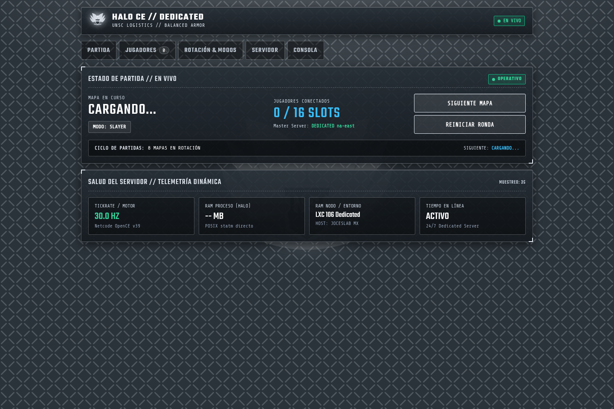
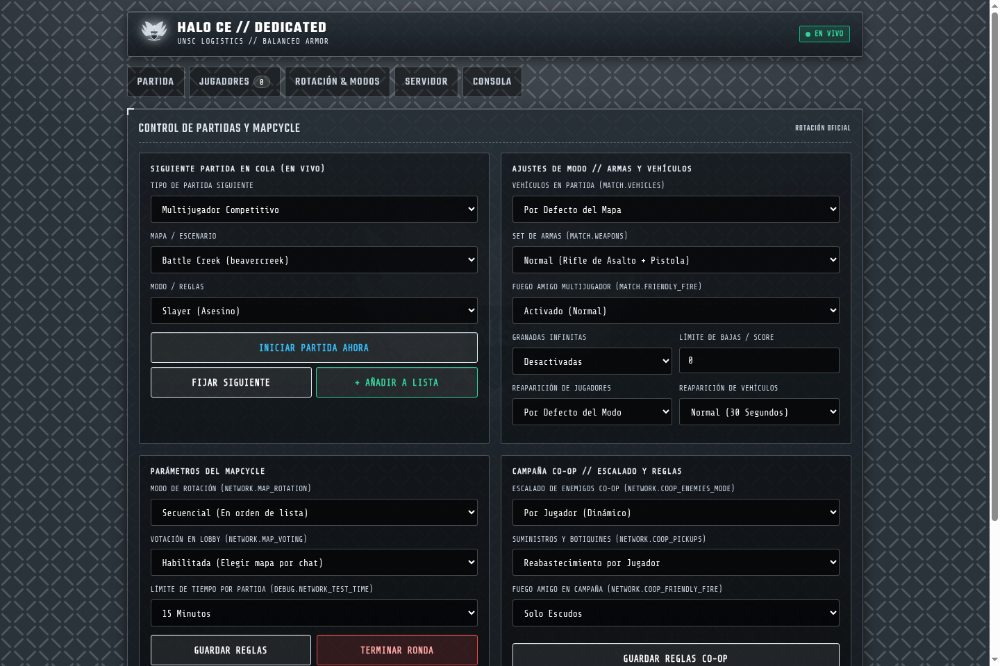
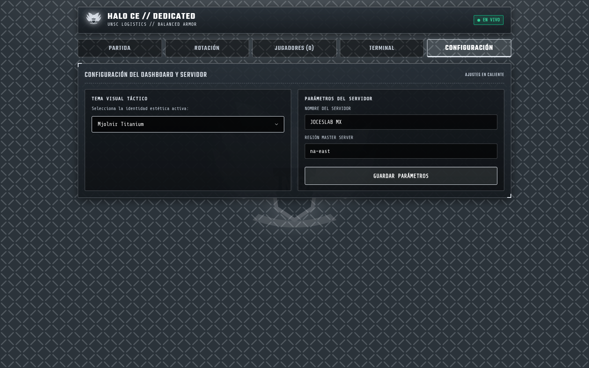

<div align="center">

# Halo CE Dedicated Server

**Headless 24/7 dedicated server for Halo: Combat Evolved (OpenCE)**

[](https://github.com/JoshRob297/halo-ce-server/releases/latest)
[](#quick-start-docker)
[](#who-can-join)
[](LICENSE)

Run a continuous multiplayer or co-op host with **no screen, no GPU, and no sound card**.<br/>
Built on the [OpenCE](https://github.com/OpenCommunityEdition/OpenCE) native port (`dhost-v38`).

[Quick Start](#quick-start-docker) • [Full Guide](#the-complete-guide-step-by-step) • [Settings](#the-settings) • [Maps & Modes](#maps-and-game-modes) • [Roadmap](docs/roadmap.md) • [En Espanol](#en-espanol)

</div>

---

### Highlights

- **Native OpenCE Netcode (v38):** Official OpenCE clients (Windows, Linux, Android, Web) connect directly without modifications.
- **Automated Map Rotation:** Define map and gametype sequences directly in `config.toml`; the server rotates and resets the lobby automatically.
- **Server Browser Discovery:** Fully discoverable in the in-game public browser or shareable via direct invite links (`halo://join/...`).
- **Low Footprint:** Runs with a null renderer and SDL dummy drivers. Lightweight enough for a basic VPS, NUC, or mini-PC.

---

## Architecture Overview

```
+-------------------------------------------------------------------------+
|                              HOST MACHINE                               |
|                                                                         |
|  +--------------------------- Docker / Bare Metal --------------------+ |
|  |                                                                    | |
|  |  Game Engine (OpenCE Core) <---> config.toml (Rotation & Limits)   | |
|  |       |                                                            | |
|  |  Virtual Audio / Video Drivers (SDL dummy, null renderer)          | |
|  |       |                                                            | |
|  |  Network Listener (UDP 2302)                                       | |
|  +-------|------------------------------------------------------------+ |
+----------|--------------------------------------------------------------+
           |
           +---> STUN / Master Browser Discovery
           |
           +---> Incoming Clients (PC, Android, Linux, Web)
```

---

## Web Dashboard

The dedicated server includes a native, zero-dependency embedded Web Dashboard listening on port `:8080`, faithfully matching the official OpenCE administration interface while preserving 100% compatibility with current official client builds (Netcode v38).

<p align="center">
  
</p>

### Key Dashboard Modules
- **Status & Telemetry:** Live map, active gametype, match time, score, uptime, and real-time 10-minute player history sparkline.
- **Rotation Manager:** Interactive playlist reordering (`Up`, `Down`, `Remove`, `Play Now`) and adding new map/rule combinations on the fly.
- **Player Administration:** Connected player monitoring with ping, IP, team affiliation, and instant moderation actions (`Kick`, `Ban`, `Mute`).
- **Settings & Console:** Visual configuration editor and embedded browser RCON terminal.

<p align="center">
  &nbsp;
  
</p>

---

## Contents

- [What You Need](#what-you-need)
- [Quick Start (Docker)](#quick-start-docker)
- [The Complete Guide, Step by Step](#the-complete-guide-step-by-step)
- [Web Dashboard](#web-dashboard)
- [Operator CLI (operator.sh)](#operator-cli-operatorsh)
- [Windows Headless](#windows-headless)
- [The Settings](#the-settings)
- [Maps and Game Modes](#maps-and-game-modes)
- [Who Can Join](#who-can-join)
- [Troubleshooting](#troubleshooting)
- [Roadmap & Limitations](#roadmap--limitations)
- [Feature Comparison: Our Edition vs Upstream](#feature-comparison-our-edition-vs-upstream-branch)
- [Credits & Attribution](#credits--attribution)
- [En Espanol](#en-espanol)

---

## What You Need

1. **Game Map Files:** You must supply the `maps/` folder extracted from **your legally owned retail disc**. The server never contains or distributes copyrighted game data.
2. **Runtime Environment:**
   - **Docker** (Recommended across all platforms), or
   - **Linux x86_64** (systemd service), or
   - **Windows** (Console / NSSM service).
3. **Network Accessibility:** One inbound UDP port (default: `2302`). UPnP is attempted automatically, but manual port forwarding is advised for dedicated servers.

### Map Extraction

A multiplayer server requires `ui.map` and any level intended for the map cycle (`bloodgulch.map`, `chillout.map`, etc.). Co-op servers additionally require the campaign maps (`a10.map`, `c10.map`, etc.). Custom Edition maps should be placed inside a `custom_maps/` directory.

Extracting maps from your retail disc image (performed once on your desktop):

```sh
# Using extract-xiso (Linux / macOS / WSL)
extract-xiso -x "Halo - Combat Evolved (USA).xiso.iso"

# Or using 7-Zip
7z x "Halo - Combat Evolved (USA).xiso.iso" maps/
```

---

## Quick Start (Docker)

Ensure Docker and Docker Compose are installed, then run:

```sh
# 1. Prepare directory structure
mkdir -p halo-server/maps

# 2. Copy extracted maps into the server folder
cp /path/to/extracted/maps/* halo-server/maps/

# 3. Retrieve compose configuration
cd halo-server
curl -fsSL -O https://raw.githubusercontent.com/JoshRob297/halo-ce-server/main/docker-compose.yml

# 4. Launch the server daemon
docker compose up -d

# 5. Monitor startup
docker compose logs -f
```

Expected log output upon successful startup:

```text
halo-linux: Internet play: hosting. Invite players with this link: halo://join/...
halo-linux: Internet play: the game is listed in everyone's server browser (public)
halo-linux: network test: hosting bloodgulch
```

---

## The Complete Guide, Step by Step

### Step 1: Prepare Game Assets

Create a clean directory for your deployment and organize the maps:

```sh
mkdir -p ~/halo-server/maps
cd ~/halo-server

# Required core UI map
cp /path/to/extracted/maps/ui.map ./maps/

# Desired multiplayer levels
cp /path/to/extracted/maps/bloodgulch.map ./maps/
cp /path/to/extracted/maps/chillout.map ./maps/
cp /path/to/extracted/maps/damnation.map ./maps/
cp /path/to/extracted/maps/sidewinder.map ./maps/
```

### Step 2: Download Docker Configurations

```sh
curl -fsSL -O https://raw.githubusercontent.com/JoshRob297/halo-ce-server/main/docker-compose.yml
curl -fsSL -O https://raw.githubusercontent.com/JoshRob297/halo-ce-server/main/server/config.toml
```

### Step 3: Configure Server Parameters

Open `config.toml` in your preferred editor:

```toml
[network]
server_name = "My 24/7 Halo Server"   # Shown in the in-game Server Browser
tunnel_port = 2302                    # Inbound UDP port for game traffic

[debug]
null_renderer = true
# Semicolon-separated map and mode definitions:
network_test = "host:bloodgulch:slayer,ctf;chillout:slayer,oddball;sidewinder:ctf"
network_test_time = 15                # Match time limit in minutes
network_test_countdown = 15           # Pre-game lobby countdown in seconds
network_test_player = true            # Spawns idle host player so match starts and allows hot-joining
```

Update `docker-compose.yml` to mount your custom `config.toml`:

```yaml
volumes:
  - ./maps:/halo/maps:ro
  - ./saved:/root/.local/share/halo-linux
  - ./config.toml:/halo/config.toml:ro
```

### Step 4: Firewall and Networking

If hosting on a VPS or behind a router with disabled UPnP, forward UDP port `2302`:

```sh
# UFW (Ubuntu / Debian)
sudo ufw allow 2302/udp

# FirewallD (RHEL / Fedora)
sudo firewall-cmd --add-port=2302/udp --permanent
sudo firewall-cmd --reload

# Windows (PowerShell as Administrator)
New-NetFirewallRule -DisplayName "Halo CE Server" -Direction Inbound -Protocol UDP -LocalPort 2302 -Action Allow
```

### Step 5: Launch and Inspect

```sh
docker compose up -d
docker compose logs -f
```

---

## Bare-Metal Installation (systemd)

If you prefer to run directly on the host without containerization:

```sh
# 1. Run the automated installer
sudo curl -fsSL https://raw.githubusercontent.com/JoshRob297/halo-ce-server/main/scripts/install-baremetal.sh | sudo bash -s -- /srv/halo

# 2. Place map files
sudo cp /path/to/extracted/maps/* /srv/halo/maps/

# 3. Adjust settings
sudo nano /srv/halo/config.toml

# 4. Start the service
sudo systemctl enable --now halo-server
sudo journalctl -u halo-server -f
```

---

## Operator CLI (operator.sh)

The server includes a lightweight management CLI (`scripts/operator.sh`) communicating directly with the internal administration console over loopback telnet (`127.0.0.1:2323`).

### Enabling the Console
In `config.toml`:
```toml
[debug]
telnet_console = true
telnet_console_port = 2323
```
Or via environment variable:
```bash
export HALO_TELNET_CONSOLE=true
```

### Usage with Docker
Run commands from the host machine using `docker exec`:
```bash
# Check live match status (map, mode, players, state)
docker exec halo-server /halo/operator.sh status

# Disconnect a disruptive player
docker exec halo-server /halo/operator.sh kick "PlayerName"

# Ban a player (writes IP + HWID with progressive tier)
docker exec halo-server /halo/operator.sh ban "Griefer"

# Trigger a host vote-kick
docker exec halo-server /halo/operator.sh votekick "AfkPlayer"

# Execute arbitrary Halo Script or debug commands
docker exec halo-server /halo/operator.sh raw "help kick"
```

### Usage on Bare Metal / Systemd
```bash
/opt/halo-server/operator.sh status
/opt/halo-server/operator.sh kick "PlayerName"
```

See [docs/operator.md](docs/operator.md) for the full guide, including chat settings, progressive ban tiers, lobby map voting, and the HTTP health endpoint.

---

## Windows Headless

The dedicated server runs natively on Windows using headless SDL dummy drivers without a display or sound card.

- **Guide & Service Setup:** See [docs/windows.md](docs/windows.md) for full instructions, manual startup commands (Command Prompt and PowerShell), Windows Firewall rules, and running as an auto-restarting background service via NSSM.
- **CI Verification:** The `windows` job on GitHub Actions (`windows-2025`) continuously builds and smoke-tests headless startup with `SDL_VIDEODRIVER=dummy SDL_AUDIODRIVER=dummy`.

---

## The Settings

All configuration is handled inside `config.toml` (or via corresponding environment variables):

| Parameter | Type | Default | Description |
| :--- | :--- | :--- | :--- |
| `debug.null_renderer` | Boolean | `true` | Suppresses graphics and window rendering. |
| `debug.network_test` | String | `""` | Rotation specifier: `"host:map:mode,mode;map:mode"`. |
| `debug.network_test_time` | Integer | `0` | Hard match limit in minutes (overrides game variant). |
| `debug.network_test_countdown`| Integer | `0` | Seconds to hold the pre-game countdown (0 = 31s). |
| `debug.network_test_start` | Float | `1.0` | Fallback timeout to enforce start if conditions hang. |
| `debug.network_test_player` | Boolean | `true` | `true`: spawns idle host player to advance countdown; allows hot-joining. |
| `audio.enabled` | Boolean | `false`| Prevents opening any audio device. |
| `network.server_name` | String | `""` | Display name for the public server browser (Max 32 chars). |
| `network.tunnel_port` | Integer | `2302` | Inbound network port. |
| `network.online` | Boolean | `true` | Enables WAN/Internet functionality (`false` = LAN only). |
| `network.host_public` | Boolean | `true` | Broadcasts listing to the public server browser. |
| `display.time_notices` | Boolean | `true` | Broadcasts match time milestones via chat. |

---

## Maps and Game Modes

### Supported Maps
Any map file present in `maps/` can be targeted by its base name:
`bloodgulch`, `chillout`, `damnation`, `hangemhigh`, `longest`, `prisoner`, `putput`, `ratrace`, `sidewinder`, `beavercreek`, `boardingaction`, `carousel`, `wizard`.

For Custom Edition maps located in `custom_maps/`, specify them with the subfolder prefix:
`custom_maps\cbeaver`

### Supported Gametypes
Chain multiple modes per map entry in `config.toml` using commas:

| Gametype Identifier | Category | Rules & Mechanics |
| :--- | :--- | :--- |
| **`slayer`** / **`team_slayer`** | Classic Halo | Free for all or team deathmatch. |
| **`ctf`** / **`ironctf`** | Classic Halo | Capture The Flag. `ironctf` disables touch-return. |
| **`oddball`** / **`team_oddball`** | Classic Halo | Hold the skull for points. Ball carrier uses skull melee. |
| **`king`** / **`team_king`** | Classic Halo | King of the Hill. Accumulate time inside moving hill. |
| **`race`** / **`team_race`** / **`rally`** | Classic Halo | Drive vehicles through checkpoint sequence. |
| **`swat`** | **OpenCE Custom** | No shields, instant headshot kills with any weapon, pistol + assault rifle spawn, no radar, no grenades on map. |
| **`infection`** | **OpenCE Custom** | Humans (Red) vs Zombies (Blue/Green). Zombies have increased speed, skull melee only. Humans killed become zombies. |
| **`gun_game`** | **OpenCE Custom** | Free for all. Each kill awards the next weapon in sequence. Kill with final weapon wins the match. |
| **`hardcore`** / **`hardcore_slayer`**| **OpenCE Custom** | No motion sensor, no aim assist. Each kill instantly restores full health and shields to the killer. |
| **`hardcore_ctf`** | **OpenCE Custom** | Capture The Flag with hardcore rules (no radar, no aim assist, kill regen). |
| **`hardcore_oddball`** | **OpenCE Custom** | Oddball with hardcore rules (no radar, no aim assist, kill regen). |
| **`hardcore_king`** | **OpenCE Custom** | King of the Hill with hardcore rules (no radar, no aim assist, kill regen). |
| **`coop`** | Campaign | Campaign cooperative missions (`a10`, `b30`, etc.). |

> **Automatic Fallback:** If a gametype requires teams (e.g. CTF) and fewer than two players join, the engine automatically selects the first non-team variant to ensure the game cycle continues smoothly.

---

## Who Can Join

| Client Type | Version | Status |
| :--- | :--- | :--- |
| **OpenCE Official (Desktop)** | v38 | Supported directly |
| **OpenCE Android APK** | v38 | Supported directly |
| **OpenCE WebAssembly Browser** | v38 | Supported directly |
| **Legacy OpenCE Clients** | ≤ v37 | Upgrade client required |

The netcode strictly requires version alignment on the client side. Current official master releases operate on network version 38.

---

## Troubleshooting

### `SDL_Init failed: No available video device`
Occurs when running the binary outside Docker without headless environment overrides. Ensure dummy drivers are exported:
```sh
export SDL_VIDEODRIVER=dummy
export SDL_AUDIODRIVER=dummy
```

### Server Does Not Appear in Server Browser
1. Verify `network.online = true` and `network.host_public = true` in `config.toml`.
2. Ensure UDP port 2302 is accessible externally. Carrier-grade NAT (CGNAT) prevents inbound server discovery.

### Server Process Ignores `kill` / `SIGTERM`
The game loop traps standard termination signals. Terminate cleanly using Docker Compose or issue `SIGKILL`:
```sh
docker compose down
# or bare metal:
sudo systemctl kill -s KILL halo-server
```

---

## Security & Anti-Cheat

The server enforces strict host authority:
- Server-authoritative inventory, weapon ammunition, grenade counts, and scoring.
- Comprehensive damage hit report validation including weapon ownership, rate-of-fire burst limits, historical target bounding spheres, and line-of-sight raycasts.
- Automatic clock skew detection against speed hacks with immediate prediction rejection and stream-verified auto-bans.

See [docs/anticheat.md](docs/anticheat.md) for the complete audit report, host protection matrix, and operator ban management guide.

---

## Roadmap & Limitations

- [x] Full headless Docker deployment.
- [x] Automated map and mode playlist rotation.
- [x] Public browser listing and invite token generation.
- [x] Interactive operator console (`operator.sh` / telnet).
- [x] Public text chat toggle (`network.public_chat`).
- [x] Join gate / server password authentication (`network.server_password`).
- [x] Server-enforced anti-cheat audit and documentation ([docs/anticheat.md](docs/anticheat.md)).
- [x] Lightweight JSON HTTP health status endpoint.
- [x] Windows headless smoke verification ([docs/windows.md](docs/windows.md)).

See [docs/roadmap.md](docs/roadmap.md) for planned milestones.

---

## En Espanol

Servidor dedicado para **Halo: Combat Evolved (OpenCE)** diseñado para correr de forma continua 24/7 en contenedores Docker o Linux sin entorno gráfico ni tarjeta de sonido.

- **Netcode v38:** Compatible con todos los clientes oficiales de OpenCE (Windows, Linux, Android y Web).
- **Rotación Automática:** Los mapas y modos se configuran en `config.toml` (`debug.network_test`). El servidor administra el ciclo de partidas de forma desatendida.
- **Descubrimiento:** Aparece en el Server Browser público oficial o mediante enlaces directos `halo://join/...`.

> **Importante:** Debes proveer tus propios archivos de mapas extraídos de tu copia original del juego. El proyecto no incluye ni distribuye contenido propietario.

Para desplegarlo en dos pasos con Docker:
```sh
mkdir -p halo-server/maps && cp /ruta/a/tus/mapas/* halo-server/maps/
cd halo-server && curl -fsSL -O https://raw.githubusercontent.com/JoshRob297/halo-ce-server/main/docker-compose.yml
docker compose up -d
```

---

## Feature Comparison: Our Edition vs Upstream Branch

| Feature | Our Dedicated Server (`halo-ce-server`) | Upstream Experimental Branch (`dedicated-server`) |
| :--- | :--- | :--- |
| **Client Compatibility** | **100% Compatible (Netcode v38)**<br>All current official Android APK, PC, and Linux players join immediately. | **Incompatible today (Netcode v39)**<br>Requires unreleased client updates not yet published to public users. |
| **Web Dashboard** | **Native Zero-Dependency Embebido (`:8080`)**<br>Interactive web admin, status facts, live player graph, and rotation editor. | Embedded in experimental branch, targeting v39. |
| **Lobby Map Voting** | **Interactive Chat Voting (`map_voting = true`)**<br>Lobby players vote for the next match by typing `1` to `N` in chat. | Fixed rotation or manual command only. |
| **Inactivity / AFK Kick** | **Automated AFK Protection (`afk_timeout = 180`)**<br>Monitors analog sticks, buttons, and aim vectors; sends private warning at $T-30$s. | Not implemented. |
| **Progressive Ban Tiers** | **Automatic Strikes (`escalating_bans = true`)**<br>Tiered bans: 1h -> 24h -> 7d -> permanent with auto-expirations. | Manual duration flag per command (`sv_ban <player> 2h`). |
| **Playlist Rotation** | **Sequential & Pseudo-Random Shuffle**<br>Avoids repeating the previous map consecutively. | Sequential playlist parser. |
| **Operator CLI** | **`operator.sh` CLI + Web Terminal + Telnet** | Console stdin, RCON WebSocket, Web Terminal. |
| **Public Deployment** | **Production-ready GHCR Docker Image (`139 MB`) + Releases** | Unmerged source code branch. |

---

## Credits & Attribution

- **[OpenCE Project](https://github.com/OpenCommunityEdition/OpenCE):** The underlying decompilation, engine architecture, and multiplayer netcode are created and maintained by the OpenCE community contributors.
- **Web Interface Architecture:** The visual dashboard layout, styles (`app.css`), and frontend client logic (`app.js`) were designed by **MrBruh / cybersecurity** in the OpenCE project. We ported and adapted the dashboard to interface directly with the Netcode v38 engine core, providing immediate availability to the community without waiting for the v39 transition.

---

## License

This packaging repository, scripts, and documentation are provided under the [MIT License](LICENSE).
Halo: Combat Evolved is a trademark of Microsoft Corporation. This project is an independent open-source tool based on the OpenCE decompilation.
